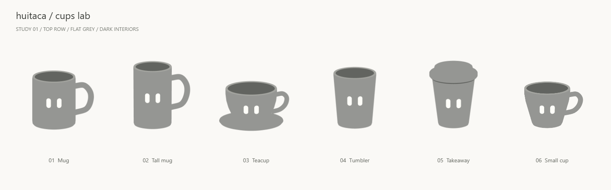

# Huitaca Cups lab

## Tea tag: frozen hanging and contact fit

- The existing Tea bag choice now reads Tea tag. It adds the reference's
  plain yellow paper (`#e2b245`) and cream string (`#e3dbd1`) on the left.
  The paper was initially 0.26 by 0.30 units; Alessandro requested a 30%
  enlargement to 0.338 by 0.39. It scales around its string attachment,
  keeping paper thickness and the complete string unchanged. A pre-change
  geometry snapshot checks the strings on all eighteen cups.
  The round string retains its 0.016-unit radius.
- Alessandro corrected the first pose: a viewer-facing paper and generous
  standoff looked unnatural from an angle. The replacement uses the actual
  cup outline to derive a taut string path. It falls vertically where free,
  touches an outward bulge and bridges inward hollows instead of following
  them. The paper shares the attachment's azimuth rather than facing the
  initial camera.
- Paper on a narrowing cup hangs vertically below the string. Where the wall
  widens into its path, the paper tilts outward just enough to rest against
  the wall, with a 0.002-unit clearance. The paper stays connected at its top.
  Tests reproduce both cases using the existing cups and rendered walls.
- Under a lid, the string flattens to 0.006 units vertically while retaining
  its width. The cover lifts 0.028 units on the takeaway and 0.038 on the
  gaiwan, accounting for existing profile overlap and leaving a 0.008-unit
  seam above the seat. Both lifts are under 2% of the original vessel height.
  Other parts and the catalogue stay unchanged.
- Takeaway correction: the hanging string releases from the retaining rim
  under the plastic overhang, not from the cover's widest edge. Its release
  radius is 0.828 rather than 0.915 units. The lid gap, paper height and
  every other cup's fitting rules are unchanged.
- All fitting happens once at model construction and is cached by vessel.
  Turning or changing elevation does not update the string or paper pose;
  there is no running physics simulation, gravity animation or billboarding.
- Tests cover all eighteen cups: left-side placement across the full gaze
  range, no visible eye-centre occlusion from frontal and front-quarter views,
  cord and paper clearance, lid compression, paper attachment, framing,
  disposal and frozen transforms. Additional tests distinguish vertical
  hanging from actual wall-supported paper.
- The existing accessory controls retain cup, selection, turn and elevation.
  Reduced motion keeps manual inspection. WebGL failure still displays and
  labels the bare grey cup; no accessory PNGs are implied or generated.
- Alessandro approved the final enlarged tag and requested this commit.
  No browser preview or screenshots were taken.
- Validation: all 704 tests across 24 files, strict TypeScript, production
  build and `git diff --check` pass. Vite retains the existing renderer
  chunk-size warning.

## Beret reference-shape correction

- Alessandro supplied the original accessory reference again and requested
  a rounder crown, a larger stem for small avatars, less sideways spread and
  a stronger downward droop. The revised profile is more compact and domed,
  with additional profile rows rounding its outline.
- The lower left fold now drops below the band, outside the cup wall.
  The band still rests on the original rim or lid seat, and the cover-clearance
  bounds include the revised droop. Existing cup and lid geometry is untouched.
- The stem is nearly twice as wide and tall, with a rounded end, a small lean
  and a position near the crown centre. The darker stem and subtle fixed edge
  tones from the previous trial are retained.
- Geometry tests check the downward fold against actual cup walls on all
  eighteen vessels. Raycasts also check distinct stem coverage in a 64-pixel
  square using the real accessory frame and starting elevation, from four
  sides. This is a geometry check, not a browser capture; Alessandro owns
  the visual review.
- Follow-up: Alessandro approved the revised silhouette and requested just
  another 20% increase to the stem. Its mesh scales uniformly by 1.2 about
  its attachment point; crown, band, placement and lean are unchanged.
- Alessandro approved the final result as clearly reading as a beret and
  requested this commit, including the edge-tone changes.
- Validation: all 579 tests across 23 files, strict TypeScript, production
  build and `git diff --check` pass. The existing renderer chunk-size warning
  remains.

## Edge-tone trial: beret and takeaway lid

- Alessandro reported that the red stem disappeared into the beret crown and
  the takeaway lid's relief read as one flat shape. The approved treatment
  applies to live WebGL previews; existing static PNGs remain unchanged.
- The beret stem now shares the deeper red of the band. Its crown and the
  takeaway lid receive subtle, baked vertex tones: horizontal faces keep
  their base colour, while vertical edges multiply linear RGB by 0.82.
  Slopes interpolate between those limits to reveal the outer fold, bevel
  and raised sip lip.
- This is not scene lighting or a shadow effect. The tones use object-space
  geometry normals once at construction, with no camera, time or light input.
  Geometry, fit, hole size, lid position and approved palette base colours
  are unchanged. Other cups and their faces remain completely flat.
- Toned lid materials are separate from ordinary materials, even when they
  share the same colour slot in the grey catalogue. Colour updates reach
  both caches without rebuilding geometry; disposal releases both caches.
- Tests check tonal bounds, the untouched top colour, separate stem colour
  and low-angle visibility, all twelve palette options and the grey lid,
  untinted bodies/eyes, material updates and disposal.
- Validation: all 560 tests across 23 files, strict TypeScript, production
  build and `git diff --check` pass. The existing renderer chunk-size warning
  remains. No browser preview or screenshots were taken.

## Red beret

- Alessandro approved a soft red beret with a broad, side-slouched crown,
  narrow band and small top stem. No badge, star, insignia or fabric texture.
  The intended reading is creative/artistic, not a uniform. Red cannot be
  claimed to have no political or military associations in every context.
  The scarf is planned in blue but remains unmodelled.
- The crown and stem use flat red `#c84444`; the band is deeper red `#a93636`.
  The band stays horizontal, while the crown spreads and falls to the left.
  All three meshes are unlit and cast no shadows.
- The band fits the actual top rim or lid-seat radius on each of the eighteen
  cups. On the takeaway it rests on the existing lid's outer flat ledge.
  On the gaiwan it rests on the seat, with the existing lid and knob enclosed
  by the crown. Neither lid is moved or removed.
- Crown height adapts to the existing cover. Conservative bounds on its
  nested polygon rings keep the shell above the lid and knob, including the
  raised takeaway sip lip. The fit is cached by vessel definition and never
  recalculated during rotation, elevation changes or idle rendering.
- Beret selection uses the existing accessory controls and manual turntable.
  It preserves cup selection, rotation and elevation when switching to or
  from the paintbrush. Reduced motion keeps manual inspection; WebGL failure
  still shows and labels the bare grey cup, not a pretend accessory still.
- Tests check all eighteen models for rim contact around the full band,
  broad slouched proportions, complete framing, unchanged cup geometry and
  colour slots. Raycasts check lid vertices and triangle interiors against
  the crown and band. Tests also cover disposal, construction-only fitting,
  accessory switching, reduced motion and the WebGL fallback.
- Visual review is left to Alessandro. No browser preview or screenshots.
- Validation: all 543 tests across 22 files, strict TypeScript, production
  build and `git diff --check` pass. Vite retains the existing warning about
  the lazy renderer chunk exceeding 500 kB.

## Paintbrush, supported fitting

- The first accessory uses the later supplied reference: mustard handle,
  cream ferrule and terracotta bristles, pointing out of the cup.
- Alessandro approved the compact revision: handles and ferrules are 30%
  thicker except on the takeaway, whose handle stays narrow for its sip hole.
  The exposed handle is 0.38 instead of 0.50 units; bristles are 40% wider
  and 0.40 instead of 0.36 units long. Total exposed length falls from 1.00
  to 0.92 units, retaining the two supports with the revised dimensions.
- Alessandro corrected the initial fixed-angle approach. Each brush now has
  two actual supports: its lower end on the interior floor and its tapered
  handle against the right opening edge. Cup height, floor and rim profiles
  determine its angle and insertion depth, not a shared chosen angle.
- The lower end starts at the floor centre. On the çay glass it moves slightly
  left to clear the narrow neck while retaining floor and rim contact.
  The takeaway uses the right sip-hole lip as its upper support; its handle
  passes through the existing throat without changing the hole.
- The gaiwan brush rests on its floor and right seat edge. Its lid pivots on
  the left seat and rests against the handle on the right. Its tilt is derived
  from those contacts, replacing the earlier chosen 22-degree tilt.
  Only the brush variant moves the lid; grey Shapes and Designs stay unchanged.
- The fit is computed once per vessel definition and cached. Nothing solves
  or adjusts the pose during rotation, elevation changes or idle rendering.
  The accessory frame supplies headroom without changing other studies.
- At this checkpoint, other accessory choices remained unmodelled. A WebGL failure still displays
  the matching bare grey cup and labels it as having no accessories.
- Validation checks floor and right-edge contact on all eighteen rendered
  models, tapered-handle clearance along the full interior, the sip-hole
  throat, the lid's two contacts, framing and construction-only fitting.
  All 464 tests across 21 files, strict TypeScript, production build and
  `git diff --check` pass.
  Visual review of this correction is left to Alessandro; no browser preview
  or screenshots were taken for it.

## Colour cup picker and takeaway lid

- Colours now offers the twelve non-cultural cups only. The six cultural
  vessels do not enter this palette study. Cup selection is independent of
  Accessories; both the chosen cup and colour are remembered between studies.
- The shared cup-picker layout places the selector above the palette on
  desktop and above the preview below 64rem. Changing colour still updates
  materials in place; changing cup rebuilds only the selected preview.
- The takeaway lid has fixed neutral slots: shell `#c4c6c0`, edge `#b9bbb5`,
  opening wall `#a4a69f`. Alessandro rejected the earlier near-white shell
  because it disappeared against the light background. The revised shell
  remains lighter than all twelve body colours, with 1.58:1 contrast on
  `#f5f5f5`. These are chosen flat colours, not measured plastic colours.
- [Reliance white sipper dome lids](https://www.yourbrandcafe.com/products/white-sipper-dome-lids-for-10-24oz-paper-hot-cups/)
  provide a reference for a separately supplied neutral lid, not a rule that
  all takeaway lids are white. Grey Shapes and Accessories remain unchanged.
  Only the Colours variant remaps the takeaway lid, edge and opening wall.
- All 144 cup/colour pairs have 512px transparent PNG fallbacks from the
  real renderer: the twelve existing mug images plus 132 additional images
  under `public/cups/stills/palette/<vessel>/<colour>.png`. Only the selected
  image is requested in static mode. No new dependencies or rendering effects.
- Validation: 370 tests, strict TypeScript and the production build pass.
  All 144 images contain the expected body and eye colours and share the
  outer bounds of the existing grey stills. The fixed takeaway lid occupies
  exactly 20,121 solid pixels in each of its twelve colour previews.
- An additional pixel-exact alpha comparison is not identical at the handle
  joins of Mug, Tall mug and Small cup (including the pre-existing mug
  palette images); the other nine forms match exactly. No vessel geometry
  or grey reference still was changed for this task.

## Accessories layout study

- Study 04 / Accessories uses a large inspection preview with a cup selector
  on the right. All eighteen original grey vessels are available, grouped
  into twelve everyday forms and six cultural forms. No palette or patterns.
- Alessandro's reference defines six choices: Paintbrush, Leaf, Beret,
  Tea bag, Headphones and Scarf. They are mutually exclusive, like the
  Designs choices. Selection is remembered when switching cups or studies.
- This initial layout checkpoint had no accessory models. The paintbrush is
  now implemented as described above; other missing previews remain labelled.
- Dragging, arrow keys and view-angle controls use the existing turntable.
  Switching cups preserves the displayed rotation and elevation. Manual
  inspection remains available with reduced motion; unavailable WebGL uses
  the matching grey still instead and hides the rotation controls.
- Below 64rem, the order is cup selector, preview, accessory choices.
  Browser layout checks covered widths 320, 390, 768, 1023, 1024 and 1440,
  including both sides of the breakpoint, with no horizontal overflow.
  These used a same-origin iframe because the browser pane owns its viewport,
  not device emulation. Light desktop and dark narrow layouts were inspected.
- All eighteen cup selections and the six single-choice options were exercised
  in the browser. Validation: 355 tests across 20 files, strict TypeScript and
  the production build pass. The existing renderer bundle-size warning remains.
  No new dependencies, lighting, shadows or automatic idle rendering.

## Podstakannik pattern study

- Russia / Glass + podstakannik joins Designs with a windows row, a leaf
  scroll and Kazakovo-style filigree, all drawn on the metal holder.
  [Sources, glass decision and adaptation notes](docs/podstakannik-patterns.md).
- Glass look, decided: no transparency. A general brown drink `#7b4526` stops
  at Y=1.88, below the rim at Y=2.10. Above it the glass is empty: pale tint
  `#b3d0cb` outside, `#93b6b0` inner wall, light rim `#dcebe8`. A flat
  `#4a2713` surface closes the drink. Holder openings repeat the drink brown.
  No highlight streak. A first version with brown up to the rim was rejected
  by Alessandro: it read neither as glass nor as a filled glass.
- The decorated face moves down to Y=1.58 so the eyes stay in the drink at
  the top of their gaze travel.
- The holder is now thin metal, 0.03 units outside the glass instead of 0.06,
  with a smaller lip and foot. This is a shared form change; the grey Shapes
  still was regenerated.
- Holder and handle are nickel `#aeb2b3`; blackening ink is charcoal
  `#3a3d40`. At most two decorative inks per design.
- The pattern band targets the `holder` part (Y=0.26–1.02). Decorated variants
  can assign colour slots per part and for the handle; the gaiwan uses the
  same mechanism. Splitting the glass at the drink level adds two flat meshes;
  the patterned draw count does not change.
- All three 512px fallbacks and the grey still use the real renderer. Live
  selection and 64px composites on `#F5F5F5` and `#262626` were inspected.
  These are rendering checks, not hardware benchmarks.
## Kulhad pattern study

- India / Kulhad joins Designs with a floral fan, two triangle rows and a
  leafy vine, preserving the supplied illustration's three motif families.
  [Sources, pigments and adaptation notes](docs/kulhad-patterns.md).
- The later pottery photograph guides the subdued palette: red earth
  `#b26443`, warm cream `#e5d9bd` and olive-charcoal `#454638`. Khamir and
  Gaatha describe geru, khari mitt and black stone/clay-based decoration,
  not a documented green pigment. These flat colours are approximations.
- At most two decorative inks are used. The rim stays terracotta by
  Alessandro's choice; the painted dark rim of the reference object is not
  treated as a standard kulhad feature. Grey Shapes remain unchanged.
- Only the decorated face moves to Y=1.22. The Y=0.18–0.84 band leaves
  0.195 units below the eyes. Geometry and draw-pass counts do not change.
- The first distinct two-ink collection exposed a coverage error in the
  shared shader. Direct channel weights replace sequential mixes, which
  leaked body colour between two inks. A real 64px PNG-export check covers
  body, each solid ink and a fully covered mixed edge: maximum RGB-channel
  error falls from 32 to 1 against independently calculated sRGB values.
- All three 512px fallbacks use the real renderer. Native 64px images were
  inspected; live pattern selection and keyboard turning (15°, Home=0°)
  were checked. Masks measure 768 × 140 at 512px and 2048 × 374 at the cap.
  Resolution settings, DPR limit, lighting-free and on-demand drawing
  remain unchanged. These are rendering checks, not hardware benchmarks.
- Final verification: 343 tests across 20 files, strict TypeScript and the
  production build pass. All three built fallbacks match their 512px sources.

## Çay glass pattern study

- Türkiye / Çay glass joins Designs with eight-point stars, diamond lattice
  and Çintamani. The first two retain the supplied illustration's geometry;
  Çintamani replaces scales by request, rather than duplicating Japanese waves.
  [Sources and adaptation notes](docs/cay-patterns.md).
- One cream ink (`#f6f4ee`) on turquoise (`#2fa3a0`), with a flat gold rim
  (`#c9a24b`). Çintamani follows the exact Met tile photograph: upright and
  inverted three-roundel groups alternate between paired, tapered diagonal
  separators. The earlier horizontal squiggles are removed.
- Only the decorated face moves to Y=1.22. The Y=0.30–0.88 band leaves 0.165
  units below the eyes. Grey Shapes, the saucer and original face stay intact.
- Native 64px renders were inspected and all three 512px fallbacks use the
  real renderer. Masks measure 896 × 123 at 512px, capped at 2048 × 280.
  Geometry, shader, draw passes and resolution settings are unchanged.
  These are texture dimensions and visual checks, not hardware benchmarks.
- Full suite: 337 tests across 20 files pass, as do strict TypeScript and the
  production build. The existing lazy-renderer chunk-size warning remains.

## Colombian pattern study

- China checkpoint committed locally as `b0b3052`; Colombian patterns and
  subsequent lotus refinements committed as `7a08dc5`. Neither was pushed.
- Colombia / Clay mug joins the existing culture selector. All three choices
  share terracotta `#b5533c` and cream `#f3eadb`, with unchanged grey Shapes.
- The stepped band follows the supplied mug reference. The second choice
  restores the staged square spirals previously in slot three; the third follows the clarified
  sketch with alternating closed upright/inverted triangles and parallel
  diagonal groups between rules. Its strokes are 75% thicker than before.
  [Sources and interpretation limits](docs/colombian-patterns.md).
- The decorated face is at Y=1.16; the Y=0.12–0.82 pattern band leaves 0.155
  units below the eyes. The handle, meshes, shader and resolution cap are
  unchanged. Masks measure 1024 × 136 for 512px exports, capped at 2048 × 272.
  Native 64px renders and matching 512px PNG fallbacks were checked.
- Colombian checkpoint: 330 tests across 20 files pass, as do strict TypeScript
  and the production build. The existing lazy-renderer chunk warning remains.
  No low-end hardware frame-time measurement is claimed.

## Gaiwan and cultural pattern selector

- Committed the yunomi checkpoint locally as `d0b0344`; no push.
- Designs remains the third study. Its right-side “Culture / vessel” selector
  switches between Japan / Yunomi and China / Gaiwan, with three patterns each.
  Each culture remembers its selected pattern. Switching vessels disposes the
  previous gallery before creating the next one; choosing a pattern reuses it.
- Gaiwan follows the supplied reference's cloud scrolls, lotus petals and fret
  border in one blue-on-ivory scheme. These are decorative interpretations,
  not replicas of ritual iconography or claims of a prescribed repeat count.
  [Research and simplification limits](docs/gaiwan-patterns.md).
- The decorated gaiwan raises the eyes to Y=1.00 and puts the pattern below
  Y=0.70, leaving 0.125 units of clear space. Its knob and foot use the same
  blue as the rim. The eighteen grey Shapes definitions retain their original
  outlines, face positions, colour slots and static previews.
- Uses the existing unlit channel-mask shader, 25% resolution margin and
  2048-pixel cap, without more meshes or passes. Three new fallbacks use the
  real renderer. For a 512px export the gaiwan mask is 896 × 87 pixels; its
  maximum is 2048 × 200. These are texture dimensions, not frame-time or
  low-end hardware performance measurements.
- The fret border uses six larger repeats, thicker strokes and one open inward
  return per unit. Checked an actual 64px render without increasing resolution.
- Lotus fans are 20% wider, with larger gaps between petals and three repeats
  instead of four. Their fallback was refreshed at the same mask resolution.
- China checkpoint: 319 passing tests, strict TypeScript and production build pass.
  The pre-existing lazy-renderer chunk-size warning remains.

## Yunomi pattern checkpoint

- At this checkpoint Designs showed only the yunomi, with a navy/cream scheme and three
  deliberately bold interpretations: seigaiha waves, tokusa stripes and
  mizutama dots. Sources are linked in the pattern notes. Repeat counts are
  composition choices, not claims about culturally prescribed numbers.
- Waves use two thick arcs per unit and half-radius row spacing so successive
  rows overlap rather than appearing as separated rings. Stripes use ten
  repeats; dots use two staggered rows of six.
- The Designs face centre is raised from 1.00 to 1.12, leaving over 0.15 units
  between the eyes and pattern band. Shapes and its grey yunomi are unchanged.
- Drag or arrow keys turn the cup through 360 degrees; Home returns to the
  front. No mouse-follow in Designs. Slow turn is optional and stops when the
  document is hidden or reduced motion is enabled. Manual rotation still works
  with reduced motion.
- SVG masters rasterize into channel masks at 25% above the projected pixel
  density in each direction, in 128-pixel screen-size buckets capped at
  2048 pixels wide. The mask follows wall arc length vertically and repeats
  around the circumference. Colours remain shader uniforms; recolouring does
  not regenerate the mask. This adds texture memory and sampling, not lights,
  shadows, a second mesh or a second pass. Finite resolution is not lossless.
- WebGL-unavailable previews use matching PNGs in `public/cups/stills/designs`.
  Reduced-motion Designs stays interactive without automatic animation.
- Added coverage for wave overlap, mask resolution, seam vertices, recolouring,
  full keyboard turns, lost pointer capture, and the three-choice picker.
  The focused cup suite has 99 passing tests; strict TypeScript and the
  production build pass. The existing lazy-renderer chunk-size warning remains.

## Separate form and colour studies

- Shapes stays an eighteen-vessel grey gallery, including its original static
  fallbacks. Colours shows only the first mug, with twelve radio choices on the
  right (below the mug on narrow screens). Choosing a colour changes material
  values, not geometry, and does not affect the Shapes catalogue.
- Navigation sits on the left on desktop and above the study below 64rem.
- The shared Light / Dark selector uses the App's `bg-tertiary` backgrounds:
  `#f5f5f5` and `#262626`. The previous Page / Sidebar preview switch is removed.
- `src/cups/palette.ts` holds the tuned choices independently of vessel JSON.
  Each has a matching mug PNG for reduced motion or unavailable WebGL.
- The offline solver's CIEDE2000 threshold of 22 is a design heuristic, not an
  accessibility standard or a guarantee of readability at every avatar size.
  No palette calculations or lighting run in the render loop.

## Current pass: eighteen shapes, with a separate cultural group

Preview: <http://localhost:5190/cups>. Original bloub: <http://localhost:5190/>.
First six approved and committed locally at `ed76d29`. No pushes.
The second six were committed at `1519ccc`. The thicker teacup border and final
cultural group are visually approved and included in this checkpoint. All
eighteen grey forms are approved. The broader lab brief remains open.

### Cultural group, visually approved

- After all twelve existing cups, as confirmed by Alessandro, a full-width divider
  introduces the final six in the original order: Colombian clay mug, gaiwan,
  yunomi, kulhad, çay glass and glass with podstakannik.
- Used the newer supplied Colombian mug's straighter outline. Kept all six grey,
  unlit and free of the coloured reference sheets' motifs. These are stylised
  outlines, not measured historical replicas or universal national types.
- Checked online sources before implementation. Source links, cultural context
  and explicit limits are stored in each vessel's `heritage` data and exposed
  by the lab's “Form notes & sources” disclosure.
- [Research notes](docs/cultural-vessels.md) explain what each source supports:
  Ráquira craft context does not authenticate the supplied Colombian mug or its
  motifs; the gaiwan gets a separate saucer and knobbed lid; the broad “Islamic
  glass” label is replaced with a specific regional çay-glass study; the Russian
  handle belongs to a lower holder, around a separate open drinking glass.
- Glass and metal are still opaque grey placeholders. Material comparisons,
  patterns and claims about particular historic decorative traditions remain
  outside this pass. No new renderer or geometry algorithm was needed.
- Added DOM coverage for the divider after twelve cards, eighteen shared-canvas
  viewports, source links, correct gaiwan description and all eighteen fallbacks
  on initial and runtime reduced-motion changes.
- Strict TypeScript, production build and 81 focused cup checks pass. Live pane:
  eighteen cards, twelve before the divider and six after it, nine source links,
  one rendered canvas and no horizontal overflow in its narrow layout.
  Generated all six cultural fallback PNGs with the actual renderer.
- The first-row performance table below is historical; it is not a measurement
  of the eighteen-vessel gallery.

### Teacup separation, visually approved

- Added a thin darker border around the teacup's base, above the saucer.
  It is an opaque revolved band in the JSON (`base-border`, colour slot `border`),
  using the same unlit material as everything else. No shadow, lighting,
  gradient, or camera-facing overlay. The cup and saucer profiles are unchanged.
  Alessandro approved a thicker version: the band now reaches Y=0.24 instead of
  Y=0.20, continuing along the same lower wall. Its fallback was refreshed.

### Second row, visually approved

- Added in the reference's order: footed bowl, round bowl, rimmed cup,
  rounded tumbler, goblet, and round mug.
- All six reuse the existing JSON outlines, unlit palette, recessed dark interiors,
  surface-following eyes and shared renderer. No new geometry code or dependency.
- The bowls have separate low feet. The rimmed cup has a thick collar. The goblet
  has a short stem and broad foot. The round mug uses the approved 1.3x handle
  flares over 0.24 units, with both terminal rings buried inside its outer wall.
- The approved first six JSON entries are unchanged. Desktop keeps six columns;
  below 64rem, three columns. Labels now count through 12 rather than 010–012.
- Generated six matching 512px fallback PNGs from the real renderer, without
  posting static previews. Review the shapes directly in `/cups`.
- Strict TypeScript, production build and all 51 focused cup tests pass. These
  cover all twelve surfaces and gaze extremes, handle joins, lid and renderer;
  new overhead-ray checks confirm clear openings into all six new interiors.
- Live pane: all twelve labels are present, one canvas has rendered, and the
  three-column narrow layout has no horizontal overflow.
- The validation table below records the first-row checkpoint, not new performance
  measurements for twelve cups.



### What was tried

- Six silhouettes in the reference's order: mug, tall mug, teacup with saucer,
  tumbler, takeaway with lid, small cup.
- Grey exteriors, darker recessed interiors, white capsule eyes. No patterns,
  lighting, shadows, transparency, or decorative colours.
- Separate revolved outer walls, thin rims, inner walls and floors. Saucer and
  lid are their own outlines. Handles use tubes along JSON curve points.
- Review correction: the small cup's lower handle stopped at the outer wall,
  leaving part of its open tube end visible. Extended its last JSON point inward
  from X=0.65 to X=0.58 without changing the rest of the cup. A regression checks
  that both complete terminal rings sit inside the wall. Refreshed its fallback
  PNG and the row preview; comparison: `docs/small-cup-handle-fix.png`.
- Next review: the teacup also had an exposed lower tube end. Fixed its overlap
  and tried Alessandro's chosen gentle flares on all four handled vessels.
  `handle.flare.length` sets the affected distance from either end in vessel
  units; `handle.flare.scale` sets the endpoint radius multiplier. After trials
  at 1.6x and 1.4x, Alessandro selected 1.3x on all four handles, over 0.24 units.
  Smoothstep blends back to the unchanged middle radius.
  This deforms existing TubeGeometry rings once at construction, adding no
  vertices, triangles, meshes, or per-frame calculations. It is an overlapping
  flared attachment, not a welded or boolean-unioned ceramic fillet.
  Endpoints were extended to bury the wider terminal rings. Regression tests now
  cover both ends of every handle, not just the small cup. All four fallback
  PNGs were refreshed. Earlier review images remain historical; no new static
  previews were generated for this pass.
- Takeaway lid: following the real-lid reference, replaced the closed rotational
  top with a generated surface and a raised lip around the viewer-right opening. An enlarged capsule
  slot passes through the lid into the dark cup interior. There is no hidden
  underside disk blocking the opening and no painted-on hole. A short dark
  throat gives the opening depth; `anchors.steam` sits at its centre for a later
  steam effect. The cap, its skirt, and the throat come from the optional JSON
  `lid` definition, without a model or boolean operation. No steam animation yet.
  Refreshed the takeaway fallback without posting another static preview.
  Final review removed the full-width ramp and its horn-like corners: only a
  narrow capsule-shaped lip rises now, with a flat outer edge. The opening is
  0.44 × 0.26, centred at `[0.40, 0]` and turned 90 degrees in the lid plane.
  Its lip uses a 0.04-unit margin and 0.08-unit falloff; the steam anchor follows it.
- A 16-degree elevated orthographic view. The slider offers 0–32 degrees.
- Eyes follow the pointer within the JSON face zone; the body turns a little too.
  Eye vertices follow the actual curved wall, so they rotate and foreshorten with it.
- A simple triangulated capsule initially clipped through the convex teacup wall.
  A subdivided capsule surface fixes this. Tests check triangle interiors as well
  as vertices, including all extremes of the gaze.
- Slow turning is opt-in. With it off, mouse following settles and stops drawing.
  This resolves the tension between continuous idle animation and zero idle work.
- One shared WebGL canvas with scissor viewports for the entire shape study.
  Pixel density is capped at 2. Hidden tabs cancel scheduled rendering.
- Runtime reduced-motion changes switch to static PNGs. Failure to create WebGL
  also selects PNGs. PNGs use the same geometry and camera as the live renderer,
  not a separate drawing.
- `exportCupPng(vessel, size)` in `src/cups/renderer.ts` returns a transparent PNG
  data URL for integer sizes from 1 to 4096. Six 512px fallbacks are checked in
  under `public/cups/stills/`.

### Alessandro's decisions

Requested: a NEW screen, plain monochrome shapes and darker interiors.
The first six and the final lid correction are approved for a local commit.
Next: the reference's second row of six. No push requested.

Selected for the current trial: fix the teacup gap and add gentle flared joins.
Approved handle flare scale: 1.3x.
Lid trial: raised on one side, with an artistically enlarged sipping opening,
without the reference's lettering or moulded details.
Review directly in the live screen; do not post static previews every iteration.

The first row's current appearance is approved as the starting point. Later
material, expression and interaction studies can build on it.

Glass look: flat opaque glass colour, selected in the podstakannik pattern study.
Sidebar A versus B: not built or selected yet.

## Validation and initial measurements

| Check | Result |
| --- | --- |
| Full test suite at the first-row checkpoint | 242 passing tests in 17 files |
| Current focused geometry and lid checks | 26 passing tests in 2 files |
| Strict TypeScript and production build | Pass |
| Shared canvas count | 1 |
| Idle rendering in the live preview | 0 new frames during an 800ms observation |
| Settled mouse-follow rendering | 0 new frames during another 800ms observation |
| Density cap | 3x input produces a 2x backing buffer in the renderer test |
| Reduced-motion live preview | All 6 static PNGs loaded; canvas hidden |
| Lazy renderer including Three.js | 558.78 kB minified / 140.56 kB gzip |
| Cup page code and vessel data | 8.25 kB minified / 3.00 kB gzip |
| Cup page CSS | 2.96 kB / 1.15 kB gzip |
| Original screen | Mounted normally; no Three.js request observed |

The bundle values come from the production Vite build, not development requests.
The full suite and production build were rerun for the first-row commit.
Lid checks cover the clear passage into the cup, the local raised lip and flat
outer edge, visibility during turns, finite geometry, and the future steam anchor.
Vite warns that the lazy renderer exceeds 500 kB before gzip. It is never in the
original screen's download path and is not requested on initial reduced-motion
visits.

Zero rendered frames is NOT a CPU-utilisation measurement. Laptop CPU percentage,
single-cup frame time, and sidebar A/B frame time remain unmeasured and deferred
with those later studies. Do not interpret this table as the final performance
comparison requested in the broader brief.

The Factory browser pane does not support viewport emulation or creating another
tab via CDP here. Actual background-tab switching could not be tested in that
pane. Hidden/resume cancellation, motion-preference changes, pointer settling,
and cleanup are covered by DOM lifecycle tests. Reduced-motion PNG switching and
pointer following were also checked in the live browser.

On this Windows setup `pnpm build` could not resolve its local `vue-tsc` command,
even with the local binary directory on PATH. The identical build steps passed
when invoked directly:

```powershell
node node_modules/vue-tsc/bin/vue-tsc.js --noEmit
node node_modules/vite/bin/vite.js build
node node_modules/vitest/vitest.mjs run --reporter=default --no-color
```

The current preview server was started with
`node node_modules/vite/bin/vite.js --host 127.0.0.1`.

## Vessel JSON format

`src/cups/vessels.json` is an array of vessel definitions. Units are arbitrary
and shared by every vessel. Y points up. An outline point is `[radius, height]`;
handle and accessory-anchor points are `[x, y, z]`. The front faces positive Z.

- `parts`: named revolved outlines, each naming a material preset and colour slot.
  Only `flat` is implemented in this first pass.
- `handle`: a curve, tube radius and colour slot, or `null`. Optional `flare`
  adds a smooth widening near both attachments, with `length` in vessel units
  and `scale` as a radius multiplier. Omit it for a constant-radius tube.
- `lid` (optional): top radius, base height, cap height, lip rise, and
  `raise.margin` / `raise.falloff`; outer/interior colour slots; and a capsule `opening`
  with `[x, z]` centre, angle in degrees, width, depth and throat-wall depth. Its generated top
  replaces the closed cap, while the rotational `parts` keep the lid's brim.
- `face`: supporting part, centre height, surface-space zone dimensions, capsule
  dimensions, eye-centre separation, and colour slot.
- `anchors`: named accessory attachment points. Nothing attaches to them yet.
- `colors`: palette slots, independent of the rendering code.

Complete example, the current mug:

```json
{
  "id": "mug",
  "name": "Mug",
  "colors": {
    "body": "#959693",
    "inside": "#626460",
    "rim": "#a3a49f",
    "eyes": "#fffef9"
  },
  "parts": [
    {
      "id": "body",
      "material": "flat",
      "color": "body",
      "outline": [[0,0],[0.66,0],[0.74,0.025],[0.78,0.07],[0.79,0.16],[0.79,1.75],[0.78,1.82]]
    },
    {
      "id": "rim",
      "material": "flat",
      "color": "rim",
      "outline": [[0.78,1.82],[0.77,1.845],[0.72,1.845],[0.70,1.82]]
    },
    {
      "id": "inside",
      "material": "flat",
      "color": "inside",
      "outline": [[0.70,1.82],[0.70,0.22],[0.65,0.16],[0,0.16]]
    }
  ],
  "handle": {
    "color": "body",
    "radius": 0.105,
    "flare": { "length": 0.24, "scale": 1.3 },
    "points": [[0.73,1.47,0],[1.10,1.50,0],[1.32,1.25,0],[1.34,0.93,0],[1.19,0.61,0],[0.69,0.46,0]]
  },
  "face": {
    "surface": "body",
    "centerY": 1.04,
    "width": 0.98,
    "height": 0.72,
    "eyeWidth": 0.17,
    "eyeHeight": 0.37,
    "separation": 0.39,
    "color": "eyes"
  },
  "anchors": {
    "top": [0,1.845,0],
    "handle": [1.34,0.93,0]
  }
}
```

The original Jérémy Perret MIT licence remains unchanged in `LICENSE`.

## Open questions / later passes

1. Add and review the reference's second row, preserving the approved first six.
2. Shall the openings be this visible, or closer to the reference's shallower view?
3. Eye size, position, and roundness; how far should their gaze and bodies follow?
4. Turning remains optional until the visual and idle-power tradeoff is chosen.
5. Russian glass A/B/C, metal/clay presets, recolourable patterns, Islamic glass,
   kulhad, bowl, and the two sidebar implementations are deliberately deferred.
6. Regenerate fallback PNGs after any geometry, palette, face or default-camera edit.
